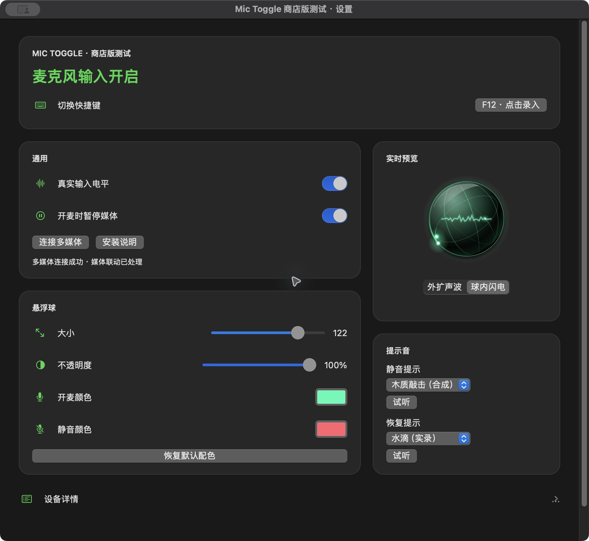

# 软件下载中心

集中提供各款软件的助手、插件和安装包，以及使用说明与更新记录。本仓库不包含应用源码。

## Mic Toggle 媒体助手

**对应软件：Mic Toggle 商店测试版（macOS 麦克风静音工具）**

这是 Mic Toggle 的可选媒体控制助手，不是麦克风主程序。配合主程序，可在开麦时暂停当前正在播放的媒体，在闭麦时恢复本次由助手暂停的同一媒体。Mic Toggle 原版已内置媒体控制，不需要另外安装此助手。

[下载媒体助手（Apple 芯片 Mac）](https://github.com/zhongcaidelaoren/app-downloads/releases/download/mic-toggle-media-helper-v0.1.1-build3/Mic-Toggle-Media-Helper-macOS-arm64.zip) · [版本说明](https://github.com/zhongcaidelaoren/app-downloads/releases/tag/mic-toggle-media-helper-v0.1.1-build3)

### 软件画面

下图为配套的 **Mic Toggle 商店测试版主程序**，不是助手独立窗口。

### 安装与使用

1. 下载并解压媒体助手 ZIP。
2. 如果旧助手正在运行，先在其菜单中选择“恢复媒体并退出”，避免多个助手同时运行。
3. 将 `Mic Toggle Media Helper.app` 放入 Mac 的“应用程序”文件夹。
4. 打开配套的 Mic Toggle 商店测试版，在设置中开启“开麦时暂停媒体”。主程序会自动查找、启动并连接助手，无需复制配对码。
5. 显示“多媒体连接成功”后即可使用；需要重试时点击“连接多媒体”。之后主程序启动且媒体联动开启时，会自动连接。

安装完成后可以删除 ZIP；需要使用媒体联动时，请保留助手应用。卸载前先退出助手，再将其移到废纸篓。卸载助手不会影响主程序的麦克风控制。

### 适用范围与版本状态

- Apple 芯片（arm64），macOS 13 或更高版本；本包不支持 Intel Mac。
- 配套主程序：Mic Toggle 商店测试版 0.2.0、构建 3 的本次自动连接/媒体恢复修订包。测试版按助手文件摘要匹配；若提示版本不匹配，请使用配套构建。
- 当前为**公开测试包**，使用临时签名，尚未完成 Developer ID 签名和苹果公证，也不代表已通过 Mac App Store 审核。macOS 可能阻止启动。
- 仅通过本机连接交换媒体控制请求，不上传音频或播放信息，不需要管理员权限。
- 用户已在当前测试 Mac 上确认暂停与恢复可用，不代表所有播放器和系统版本都已验证。媒体系统接口可能受 macOS 更新影响。
- Release 中的 `Source code` ZIP / tar.gz 是本下载仓库的说明与图片，不是 Mic Toggle 应用源码。

### 第三方许可

媒体助手包含 MediaRemote Adapter，遵循 BSD-3-Clause 许可。许可文件随应用包提供，另见 [第三方许可](THIRD-PARTY-NOTICES.txt)。

## 后续软件

其他软件的助手、插件和安装包也将按软件名称分别列在这里，并使用独立的 Release 标签，方便查找。
